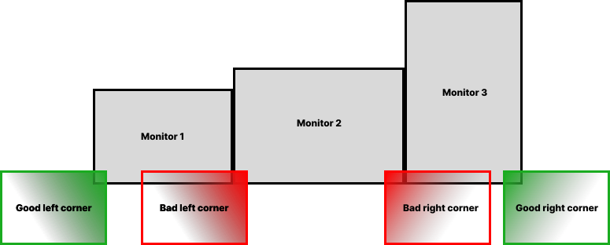
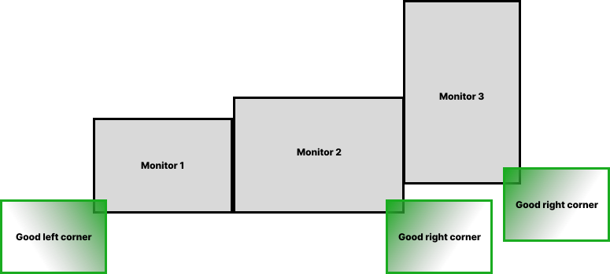
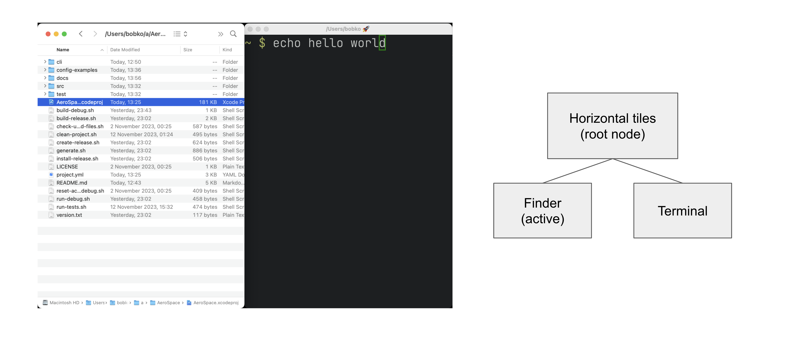
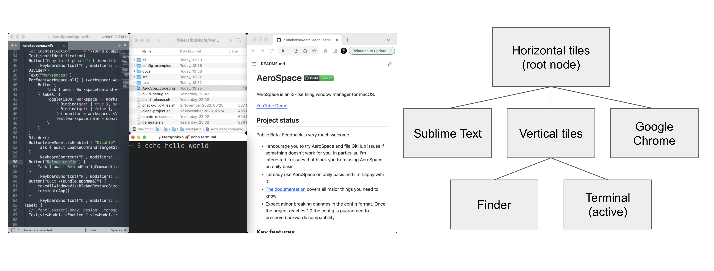
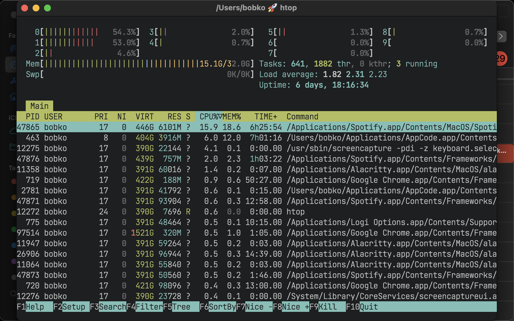
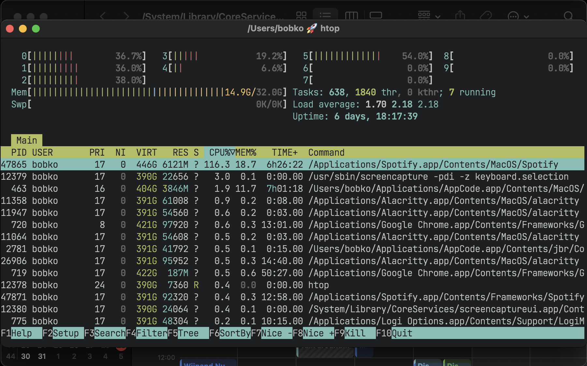

= AeroSpork Guide
include::util/site-attributes.adoc[]

include::util/header.adoc[]

AeroSpork is an i3-like tiling window manager for macOS. This guide has five parts:

. <<get-started>> takes you from the download to your first tiled windows.
. <<how-to>> gives the procedures for common tasks.
. <<how-aerospork-works>> explains the model: the tree, workspaces and monitors.
. <<troubleshooting>> tells you what to do when something goes wrong, and what a bug report needs.
. <<config-reference>> describes every config key.

[#get-started]
== Part 1. Get started

[#installation]
=== Install

AeroSpork needs macOS 13 or later, on Apple silicon or Intel.

[#homebrew-installation]
==== Install with Homebrew

[source,bash]
----
brew install --cask wbsmolen/tap/aerospork
----

The cask installs the app, links the CLI onto your `PATH`, and installs the man pages and the bash,
fish and zsh completions. If your shell does not complete `aerospork` commands, configure it for
Homebrew's completions: https://docs.brew.sh/Shell-Completion

[#manual-installation]
==== Install from the release zip

. Download `aerospork-v<version>.zip` from the https://github.com/wbsmolen/aerospork/releases[releases page].
  The other zip, `AeroSpork-<version>.zip`, is the update archive. It holds only the app.
. Open the zip. Finder unpacks it to a folder named `aerospork-v<version>`.
. Move `AeroSpork.app` from that folder to `/Applications`.
. Optional: to use the CLI, link it onto your `PATH`.
  `/usr/local/bin` belongs to root, and a new Apple silicon Mac does not have it, so use `sudo`:
+
[source,bash]
----
sudo mkdir -p /usr/local/bin
sudo ln -s /Applications/AeroSpork.app/Contents/MacOS/aerospork-cli /usr/local/bin/aerospork
----
+
Do not copy `bin/aerospork` out of the unpacked folder. It is a relative link into the app, so a
copy points at nothing.

The unpacked folder also holds the man pages (`manpage/`) and the shell completions
(`shell-completion/`).

[#first-launch]
=== Grant Accessibility permission

AeroSpork moves windows through the macOS Accessibility APIs, so it needs Accessibility permission.
The first time you open AeroSpork, macOS asks for the permission and AeroSpork quits.

. Open AeroSpork. macOS shows a dialog that asks for Accessibility access, and AeroSpork quits.
. Open System Settings > Privacy & Security > Accessibility.
. Enable AeroSpork.
. Open AeroSpork again. Its icon appears in the menu bar, and AeroSpork tiles the windows on your
  screen.

If AeroSpork quits again, the permission is not enabled. Do the steps again.

[#gatekeeper]
=== If macOS blocks the app

Each release has a Developer ID signature and a stapled notarization ticket from Apple. Gatekeeper
accepts a release, and you do not see a warning.

If you see this message, the copy you have is not a release. It is a build from source, or a
download that changed in transit:

----
"AeroSpork.app" can't be opened because Apple cannot check it for malicious software.
----

. Delete that copy.
. Download a release from the https://github.com/wbsmolen/aerospork/releases[releases page], and
  install it again.

To run that copy anyway, open System Settings > Privacy & Security, and click Open Anyway next to
the message about AeroSpork. This is a decision to trust that copy.

[#first-tiled-windows]
=== Your first tiled windows

With no config of your own, AeroSpork runs the <<default-config,default config>>. Its modifier is
`alt` (the Option key), and it declares workspaces 1 to 9.

. Open two or three windows, for example two Terminal windows and TextEdit. AeroSpork tiles them
  side by side on workspace 1.
. Press `alt-h` and `alt-l` to move the focus left and right. `alt-j` and `alt-k` move it down and
  up.
. Press `alt-shift-h` or `alt-shift-l` to move the focused window.
. Press `alt-slash` to switch the layout between horizontal and vertical tiles. Press `alt-comma` for
  the accordion layout.
. Press `alt-shift-2` to send the focused window to workspace 2. Press `alt-2` to go there, and
  `alt-1` to go back.

The comments of the default config list every binding that it generates. The menu bar icon shows
the workspace on each monitor.

[#configuring-aerospork]
=== Make the config yours

The default config lives inside the app, and AeroSpork does not change it. To change a key, copy the
default config to your home folder and edit the copy:

[source,shell]
----
cp /Applications/AeroSpork.app/Contents/Resources/default-config.toml ~/.aerospork.toml
----

When you save the file, AeroSpork loads it at once. You do not need to restart AeroSpork or run
`reload-config`.

Start from a copy of the default config, not from an empty file. A key that you leave out gets its
built-in default, and that value is often different from the default config: for example, without
`mod` AeroSpork generates no bindings at all. See <<built-in-defaults>>.

AeroSpork does not start at login until you set `start-at-login = true`, or enable "Start AeroSpork
at login" in the General pane of the Settings window.

[#open-settings]
=== Open the Settings window

The Settings window edits the same config file. To open it, do one of these:

* Click the menu bar icon, then click Settings….
* Press `cmd-comma` while AeroSpork is the frontmost app.
* Open AeroSpork again while it runs.
* Run `aerospork open-settings`.

A change in a pane applies about 0.6 seconds after you make it. The Raw TOML pane applies only when
you click Apply. <<settings-gui>> describes the panes and what the Settings window writes.

[#updates]
=== Updates

AeroSpork checks for updates only when you allow it. On its second launch, AeroSpork asks once
whether to check automatically. To check now, click the menu bar icon, then click Check for
updates….

AeroSpork accepts only an update that has the signature of the AeroSpork release key. A Homebrew
install can also update with `brew upgrade --cask aerospork`.

The update check is the only network request that AeroSpork makes. The
https://aerospork.app/privacy.html[privacy page] lists what the request sends and what AeroSpork
stores on your Mac.

[#how-to]
== Part 2. How to

[#coming-from-aerospace]
=== Switch from AeroSpace

AeroSpork reads `~/.aerospork.toml` or `~/.config/aerospork/aerospork.toml`. It never reads
AeroSpace's `~/.aerospace.toml` or `~/.config/aerospace/aerospace.toml`. With only an AeroSpace file
present, AeroSpork runs its default config. It writes a hint to stderr and to the `config` log, and
shows no message, so the only sign is the default keymap.

. Copy your AeroSpace config to `~/.aerospork.toml`.
. Rename every `AEROSPACE_*` environment variable in it to `AEROSPORK_*`:
  `AEROSPORK_FOCUSED_WORKSPACE`, `AEROSPORK_PREV_WORKSPACE`, `AEROSPORK_WINDOW_ID` and
  `AEROSPORK_WORKSPACE`. AeroSpork never sets the `AEROSPACE_*` names.
. Change every call of the `aerospace` CLI to `aerospork`. AeroSpork loads a line that still says
  `AEROSPACE_` or runs `aerospace`, and writes a warning that names the line.
. In `\[[on-window-detected]]`, write `if` as a table (`if.app-id = '...'`). AeroSpork rejects
  AeroSpace's string form, `if = 'test %{...}'`, with an error that names the replacement. Spell
  `if.during-aerospace-startup` as `if.during-aerospork-startup`.
. Save the file. AeroSpork loads it at once.

Other differences:

* `config-version`, `auto-reload-config`, `on-mode-changed` and `focus-follows-mouse` have no
  AeroSpork equivalent. AeroSpork reports these keys and ignores them. It does not reject the file.
  A saved config always reloads by itself.
* A window rule can run only `layout floating`, `layout tiling` and `move-node-to-workspace`.
* `persistent-workspaces` works as it does in AeroSpace, and so does `workspaces`. See
  <<persistent-workspaces>>.
* The first time AeroSpork starts with a config in the v1 spelling (bindings under
  `[mode.main.binding]`), it rewrites the file in the v2 spelling and keeps the original as
  `<name>.pre-v2`. The comments survive only in the `.pre-v2` copy. See <<config-v2>>.

[#pin-a-workspace-to-a-monitor]
=== Pin a workspace to a monitor

A pin keeps a workspace on one monitor. With the built-in default
`auto-move-workspaces-on-monitor-connect = true`, AeroSpork moves a pinned workspace back to its
monitor when the monitor connects, so a dock restores your arrangement.

Pin by UUID. The UUID identifies one physical monitor, and it is the only value that separates two
monitors of the same model. A DisplayLink monitor reports no vendor, model or serial number, so
its UUID is the only value that identifies it.

To pin a workspace in the Settings window:

. Connect the monitor, or the dock.
. Open the Settings window, and select the Monitors pane.
. Under "Connected monitors", find the monitor, and click "Pin a workspace here".
. Select the workspace. The pane pins it by UUID when the monitor reports one, and by name otherwise.

To pin a workspace in the config:

. Connect the monitor, or the dock.
. List the monitors and their fingerprints:
+
[source,shell]
----
aerospork list-monitors --format '%{monitor-id} %{monitor-name} %{monitor-fingerprint}'
----
+
The output has one line for each monitor. For example, the built-in monitor and two DisplayLink
monitors:
+
----
1 Built-in Retina Display { vendor_id = "0x0610", model_id = "0xA050", display_name = "Built-in Retina Display", width_pixels = 1512, height_pixels = 982, uuid = "37D8832A-2D66-02CA-B9F7-8F30A301B230" }
2 DisplayLink 1 { display_name = "DisplayLink 1", width_pixels = 2560, height_pixels = 1440, uuid = "9C1E4F0B-6A2D-4E8A-9B1C-2F3D4E5F6A7B" }
3 DisplayLink 2 { display_name = "DisplayLink 2", width_pixels = 2560, height_pixels = 1440, uuid = "1A2B3C4D-5E6F-4A8B-9C0D-1E2F3A4B5C6D" }
----
+
The two DisplayLink monitors have the same size and no vendor or model. Only the UUIDs differ.
. Copy the `uuid` value of each monitor that you want to pin.
. Add a line to `[monitors]` for each workspace. The key is the workspace, and the value is the
  monitor:
+
[source,toml]
----
[monitors]
1 = 'main'
2 = { uuid = '9C1E4F0B-6A2D-4E8A-9B1C-2F3D4E5F6A7B' }
3 = { uuid = '1A2B3C4D-5E6F-4A8B-9C0D-1E2F3A4B5C6D' }
----
. Save the file.
. Check that each workspace is on its monitor:
+
[source,shell]
----
aerospork list-workspaces --all --format '%{workspace} %{monitor-name}'
----
. Disconnect the dock, and connect it again. Run the command in the previous step again. The pinned
  workspaces are back on their monitors.

If parts of off-screen windows show on a monitor after this, see <<proper-monitor-arrangement>>.
<<assign-workspaces-to-monitors>> lists the other patterns: `main`, position, name and the other
fingerprint fields.

[#send-an-app-to-a-workspace]
=== Send an app to a workspace, or float it

A window rule runs when a window of an app appears. To send an app to a workspace, or to float its
windows, add a line to `[on-window]`. The key is the bundle ID of the app:

[source,toml]
----
[on-window]
'com.apple.mail' = 'move-node-to-workspace 3'
'com.apple.systempreferences' = 'layout floating'
----

To find the bundle ID of an app, do one of these:

* Run `aerospork list-apps` while the app runs.
* Look in the xref:./goodies.adoc#popular-apps-ids[table of popular apps].
* Run `mdls -name kMDItemCFBundleIdentifier -r /Applications/App.app`.

To do the same in the Settings window:

. Open the Settings window, and select the Window Rules pane.
. Click the add button below the list.
. Click "Choose app…", and select the app.
. Set what the rule does: the workspace to move the window to, or Float or Tile.

To match by app name, window title or workspace, see <<on-window-detected-callback>>.

[#binding-modes]
=== Add a binding mode

A binding mode is a named set of bindings. When you switch to a binding mode, AeroSpork disables the
bindings of the current mode and enables the bindings of the new one. AeroSpork starts in the mode
named `main`. The feature is the same as https://i3wm.org/docs/userguide.html#binding_modes[the one in i3].

`[keys]` holds the bindings of `main`, and `[keys.<mode>]` holds the bindings of another mode. A
mode needs a binding that enters it, and a binding that leaves it:

[source,toml]
----
[keys]
alt-r = 'mode resize'          # A binding in 'main' that enters 'resize'

[keys.resize]                  # The 'resize' binding mode
minus = 'resize smart -50'
equal = 'resize smart +50'
esc = 'mode main'              # A way back to 'main'
----

The default config has one more example, the `service` mode on `alt-shift-semicolon`.

[#key-mapping]
=== Use a non-QWERTY keyboard layout

AeroSpork reads the keys in your bindings as the QWERTY layout. For Dvorak or Colemak, select the
preset:

[source,toml]
----
[key-mapping]
preset = 'dvorak'  # or 'colemak'
----

For another layout or alphabet, or for an alias of a key, map a name to a QWERTY key:

[source,toml]
----
[key-mapping.key-notation-to-key-code]
unicorn = 'u'

[keys]
alt-unicorn = 'workspace wonderland'
----

[#run-a-script-on-focus-change]
=== Run a script when focus changes

An event callback runs commands when the focus changes. To make the mouse follow the focus, run
`move-mouse` in one:

[source,toml]
----
# The mouse follows the focused monitor (the default in i3)
on-focused-monitor-changed = ['move-mouse monitor-lazy-center']
# Or: the mouse follows every focus change, of a window or of a workspace
# on-focus-changed = ['move-mouse window-lazy-center']
----

To tell a status bar about a workspace change, run a shell command with `exec-and-forget`. The
command gets `AEROSPORK_FOCUSED_WORKSPACE` and `AEROSPORK_PREV_WORKSPACE`:

[source,toml]
----
on-focused-workspace-changed = ['exec-and-forget sketchybar --trigger aerospork_workspace_change FOCUSED_WORKSPACE=$AEROSPORK_FOCUSED_WORKSPACE']
----

The goodies page has the complete
xref:./goodies.adoc#show-aerospork-workspaces-in-sketchybar[Sketchybar recipe].
<<event-callbacks>> describes each callback.

[#proper-monitor-arrangement]
=== Arrange monitors so off-screen windows stay off screen

AeroSpork moves the windows of a workspace that is not visible past an edge of their monitor. It
tries the bottom right corner, the bottom left corner, then the right edge and the left edge. If no
other monitor touches one of those places, the windows stay out of sight.

. Open System Settings > Displays > Arrange.
. Arrange the monitors so that each monitor has free space next to one bottom corner or one side
  edge. Monitors stacked one above the other are fine if one side of each is free.

If a monitor has no free space on any side, parts of its off-screen windows show on the other
monitors.

.Bad monitor arrangement. Monitor 2 has no free space beside either bottom corner or either side

.Good monitor arrangement. Every monitor has free space beside one of its bottom corners

To make the 1-pixel edges less visible, put the Dock at the bottom of the screen, and enable
"Automatically hide and show the Dock" in System Settings > Desktop & Dock.

[#how-aerospork-works]
== Part 3. How AeroSpork works

[#terms]
=== Terms

This guide uses one term for each thing:

window:: A macOS window that AeroSpork manages. A window is a leaf of the tree.
container:: A node of the tree that holds windows or other containers. It has a layout and an
orientation.
node:: A window or a container.
layout:: How a container shows its children: `tiles` side by side, or `accordion` on top of each
other.
tiling, floating:: The state of a window. A tiling window is part of the tree. A floating window is
not.
workspace:: A set of windows that AeroSpork shows or moves off screen together. It replaces a macOS
Space.
visible workspace:: The workspace that a monitor shows. Each monitor has one.
focused workspace:: The visible workspace that has the focus. There is one.
off screen:: The place of the windows of a workspace that is not visible: past an edge of the
monitor. Compare with hidden.
hidden:: The state of an app that macOS hides, with `cmd-h` for example.
monitor:: A physical display. "Display" appears only in names that macOS uses, such as "Displays have
separate Spaces".
main monitor:: The monitor that macOS uses for the menu bar (System Settings > Displays > Use as).
pin:: A line in `[monitors]` that keeps a workspace on one monitor.
binding:: A key and the command that it runs.
binding mode, mode:: A named set of bindings. AeroSpork starts in `main`.
window rule:: A rule that runs when a window appears: a line of `[on-window]`, or a
`\[[on-window-detected]]` table.
event callback:: Commands that run when the focus changes, such as `on-focus-changed`.
config:: The TOML file that AeroSpork reads.
default config:: The config file that ships inside the app. AeroSpork uses it when you have no
config.
built-in default:: The value of a key that your config leaves out.
v1 spelling, v2 spelling:: Two ways to write the same config. See <<config-v2>>.
Settings window, pane:: The window that edits the config, and one of its seven sections.
bundle ID:: The identifier of an app, such as `com.apple.mail`. `if.app-id` matches it.

[#tree]
=== The tree

AeroSpork keeps all windows and containers of a workspace in a tree. The model comes from
https://i3wm.org/docs/userguide.html#tree[i3].

* Each workspace has one root container.
* A container can hold any number of child nodes.
* A window is always a leaf. A window has no children.
* Each container has a <<layouts,layout>> (`tiles` or `accordion`) and an orientation
  (`horizontal` or `vertical`).

The layout of a window means the layout of its parent container.

NOTE: i3 uses different terms. A "container" in i3 is a "node" in AeroSpork.

.Simple tree structure. Two windows side-by-side

.Complex tree structure

Containers can nest to any depth. The xref:commands.adoc#focus[focus] command moves the focus in
four directions: left, down, up and right.

Three commands change the tree:

. xref:commands.adoc#move[move]
. xref:commands.adoc#join-with[join-with]
. xref:commands.adoc#split[split], for i3 compatibility. While
  `enable-normalization-flatten-containers` is on (the built-in default), `split` fails with an
  error. Use `join-with` instead.

[#layouts]
==== Layouts

AeroSpork has four layouts:

* `h_tiles`, horizontal tiles. i3 calls it "horizontal split".
* `v_tiles`, vertical tiles. i3 calls it "vertical split".
* `h_accordion`, horizontal accordion. It is like the "tabbed" layout of i3.
* `v_accordion`, vertical accordion. It is like the "stacked" layout of i3.

The <<tree,tree section>> shows the `tiles` layout.

In an accordion layout, the windows are on top of each other. The horizontal accordion shows
padding on the left and the right to show that other windows are in those directions. The vertical
accordion shows padding at the top and the bottom. `accordion-padding` sets the size of the
padding.

.Horizontal accordion

.Vertical accordion

As in a `tiles` layout, the xref:commands.adoc#focus[focus] command moves through an accordion:
`focus left` and `focus right` in an `h_accordion`, `focus up` and `focus down` in a `v_accordion`.

[#normalization]
==== Normalization

By default, AeroSpork applies two normalizations to the tree:

. A container that has only one child is flattened. The root container is an exception: it can have
  a single window as its child. `enable-normalization-flatten-containers` controls this.
. Containers that nest in each other have opposite orientations.
  `enable-normalization-opposite-orientation-for-nested-containers` controls this.

[.lead]
*Example 1*

The first normalization does not permit this tree:

----
h_tiles (root node)
└── v_tiles
    └── window 1
----

AeroSpork changes it at once to:

----
v_tiles (new root node)
└── window 1
----

[.lead]
*Example 2*

The second normalization does not permit this tree:

----
h_tiles
├── window 1
└── h_tiles
    ├── window 2
    └── window 3
----

AeroSpork changes it at once to:

----
h_tiles
├── window 1
└── v_tiles
    ├── window 2
    └── window 3
----

With the normalizations, you can read the tree from the positions of the windows on the screen.
Keep them enabled unless you have a specific reason. To disable them:

[source,toml]
----
enable-normalization-flatten-containers = false
enable-normalization-opposite-orientation-for-nested-containers = false
----

[#floating-windows]
==== Floating windows

A floating window is not part of the <<tree,tree>>, with one exception: the
xref:commands.adoc#focus[focus] command treats it as part of the tree. The parent container of a
floating window is the smallest tiling container whose area contains the center of the floating
window. Thus, you do not need a separate binding to focus floating windows.

xref:commands.adoc#move[move] and xref:commands.adoc#resize[resize] work on floating windows too.
By default they keep a floating window on its monitor, because each monitor shows only its own
workspace. With `move --boundaries all-monitors-outer-frame`, a floating window that reaches the
edge moves to the next monitor.

[#commands]
==== Commands

Commands change AeroSpork and query its state. You can use a command in two ways:

* Bind it to a key in the config:
+
[source,toml]
----
[keys]
# Bind alt-f to one command
alt-f = 'fullscreen'
# Or bind a sequence of commands: move the window to workspace 1, then follow it
alt-ctrl-1 = ['move-node-to-workspace 1', 'workspace 1']
----
* Run it from the CLI:
+
[source,bash]
----
aerospork workspace 1
----

The xref:commands.adoc[command reference] lists every command.

[#emulation-of-virtual-workspaces]
=== Workspaces instead of Spaces

AeroSpork does not use macOS Spaces. It shows the windows of the visible workspace, and moves the
windows of every other workspace off screen. macOS Spaces have several limits that AeroSpork
avoids:

* Each switch between Spaces is animated. The animation cannot be disabled. "Reduce motion" only
  makes it shorter.
* The number of Spaces is limited: 16 with one monitor.
* A shortcut can only switch between Spaces. It cannot create, delete or reorder a Space, or move a
  window to another Space.
* Apple provides no public API for any of those operations.

The windows of a workspace that is not visible sit past the bottom right or bottom left corner of
their monitor. When neither corner of a monitor is free, they sit past its right or left edge. macOS
does not let a window go fully off screen, so a 1-pixel edge of each off-screen window stays
visible. When you switch to the workspace, with the xref:commands.adoc#workspace[workspace] command
or `cmd-tab`, AeroSpork brings its windows back.

Keep a single macOS Space, or one Space for each monitor if "Displays have separate Spaces" is on,
and use workspaces instead of Spaces. The menu bar icon shows the visible workspace of each monitor,
and marks the focused one.

When you quit AeroSpork, it brings every window back on screen. A tiled window is centered on the
monitor of its workspace. A floating window goes back to the spot where you put it. `killall
AeroSpork` runs the same cleanup, but if AeroSpork is stuck and the cleanup is not done after 10
seconds, AeroSpork exits without it. A crash does not run the cleanup either. In both cases, windows
can stay off screen. See <<windows-off-screen>>.

[#workspace-memory]
==== What a restart keeps

When AeroSpork restarts, it puts back the whole layout:

* The workspace of each window, and the monitor of each workspace.
* The workspace that each monitor showed.
* The tree of each workspace, with its split sizes and layouts.
* The place of each floating, fullscreen and minimized window.

AeroSpork knows a window by the ID that the macOS window server gives it. The memory lasts as long
as the window server does. A restart of AeroSpork keeps it: an update, a crash, `killall`, or Quit
from the menu bar. A logout, a restart of the Mac, or a quit and relaunch of an *app* do not keep
it, because macOS then gives the windows new IDs. AeroSpork does not guess. It places such a window
by where the window is on the screen.

To send the windows of an app to a specific place after the app restarts, write a
<<on-window-detected-callback,window rule>>. A window rule does not run again on a window that
AeroSpork remembers, unless the rule has `if.during-aerospork-startup = true`.

AeroSpork keeps this memory in `~/Library/Caches/com.wbs.aerospork/workspace-memory.json`, which
only your user account can read. If you delete the file, you lose one restart's worth of placement
and nothing else.

[#multiple-monitors]
=== Multiple monitors

All monitors share one pool of workspaces:

* Each monitor shows its own workspace, the visible workspace of that monitor.
* Two monitors cannot show the same workspace at the same time.
* Each workspace has a monitor, even while it is empty or not visible.
* By default, a workspace belongs to the main monitor.

When you switch to a workspace, AeroSpork shows the workspace on its monitor, and focuses it. To
move a workspace to another monitor, use
xref:commands.adoc#move-workspace-to-monitor[move-workspace-to-monitor]. To keep a workspace on one
monitor, <<pin-a-workspace-to-a-monitor,pin it>>.

The shared pool rests on [#observation]*an observation*: most users keep only a few workspaces on
their other monitors. Those monitors usually have one task, such as a browser, a shell, or logs and
dashboards. So one workspace for each other monitor, and the rest on the main monitor, is a common
fit.

NOTE: AeroSpork and i3 differ in one place: a switch to an empty workspace. AeroSpork shows an empty
workspace on its own monitor. i3 shows it on the focused monitor. The AeroSpork model fits
<<observation,the observation>>, and it treats empty and non-empty workspaces the same way.

[#macos-features]
=== macOS features that interact with AeroSpork

[#automatically-unhide-macos-hidden-apps]
==== Hidden, minimized and fullscreen windows

macOS can take a window out of the tiles: when you hide its app (`cmd-h`, or `cmd-alt-h` for "Hide
Others"), when you minimize it, and when you put it in native fullscreen. AeroSpork keeps the place
of such a window. When the window comes back, it goes back to its place in the tree, at its share
of the split. The other windows grow to fill the space while it is away.

To stop `cmd-h` from making windows disappear, set:

[source,toml]
----
automatically-unhide-macos-hidden-apps = true
----

With `true`, AeroSpork shows every hidden app again at once, and focuses the app that you hid with
`cmd-h`, so the shortcut does nothing. Only workspaces then make windows disappear. "Hide Others" is
undone too, but AeroSpork does not change the focus for it. The built-in default is `false`.

A window with native tabs takes one tile, however many tabs it has. The tile follows the selected
tab.

[#a-note-on-mission-control]
==== Mission Control

With many off-screen windows in the bottom corners, Mission Control draws all windows smaller than
it needs to. To fix this, enable "Group windows by application":

[source,bash]
----
defaults write com.apple.dock expose-group-apps -bool true && killall Dock
----

Or enable it in System Settings > Desktop & Dock > Group windows by application.

[#a-note-on-displays-have-separate-spaces]
==== Displays have separate Spaces

Disable "Displays have separate Spaces", unless you need native fullscreen on more than one monitor.
macOS enables it by default. With it enabled, users report these problems:

* The wrong window can get the focus with several monitors. This is a bug in an Apple API.
* The wrong borderless Alacritty window can get the focus, even with *one* monitor. This is a bug in
  an Apple API.
* Performance problems.
* macOS can move the focus back on its own.

With the setting enabled, a move to another monitor is also a move to another Space. The public
APIs that AeroSpork uses do not know about Spaces, so they do not handle that move correctly.

|===
| |"Displays have separate Spaces" enabled |"Displays have separate Spaces" disabled

|Can a window span several monitors?
|No. This is a macOS limit.
|Yes

|Stability and performance
|Focus and performance problems can occur (see the list above)
|The public Apple APIs are more stable, and so is AeroSpork

|When the first monitor shows an app in native fullscreen
|The second monitor works independently
|The second monitor is black and unusable

|The macOS menu bar
|Shows on each monitor
|Shows only on the main monitor
|===

Native fullscreen creates a Space of its own, which brings back the problems above.

To disable the setting, run this command, then log out and log in again:

[source,bash]
----
defaults write com.apple.spaces spans-displays -bool true && killall SystemUIServer
----

Or disable it in System Settings > Desktop & Dock > Displays have separate Spaces.

[#dialog-heuristics]
==== Dialogs

AeroSpork floats every window that it identifies as a dialog. Apple provides an Accessibility API
that lets an app say which of its windows are dialogs. Many apps do not implement this API, or
implement it incorrectly. Even some Apple windows do not: for example, the Finder copy-progress
window does not report that it is a dialog.

So AeroSpork also applies its own rules. For example, AeroSpork treats a window without a
fullscreen button as a dialog, except in terminal apps such as WezTerm, Alacritty and iTerm2. The
fullscreen button and the maximize button are different buttons.

If AeroSpork floats or tiles the windows of an app the wrong way, open an issue at
https://github.com/wbsmolen/aerospork/issues. Until a fix ships, a window rule can force tiling or
floating for all windows of the app:

[source,toml]
----
[on-window]
'com.example.tiles' = 'layout tiling'     # Force tiling
'com.example.floats' = 'layout floating'  # Force floating
----

[#troubleshooting]
== Part 4. Troubleshooting and bug reports

[#binding-does-nothing]
=== A binding does nothing

. Look in the `config` log for a record `Hotkey <key> not registered` (see <<capture-logs>>):
+
[source,shell]
----
log show --last 1h --predicate 'subsystem == "com.wbs.aerospork" AND category == "config"' --style compact
----
+
That record means that another app owns the key.
. Quit or reconfigure the other app. Software that listens to global keys, such as skhd,
  Karabiner-Elements and Raycast, is the usual cause.
. If there is no such record, check that your config loaded. See <<config-problem>>.

[#config-problem]
=== Is my config the problem?

[source,shell]
----
aerospork config --config-path      # which file is loaded now
aerospork reload-config --dry-run   # parse the config, and do not apply it
----

Run `--config-path` first:

* A path inside the app (`…/AeroSpork.app/Contents/Resources/default-config.toml`) means that
  AeroSpork runs the default config. You have no config, or yours failed to load at startup.
* Your own path means that your config loaded. If an edit then does nothing, the edited file did not
  parse, and AeroSpork kept the config that it had before.

In both cases, `reload-config --dry-run` tells you why.

[#windows-off-screen]
=== Windows are stuck off screen

If AeroSpork crashes, or you stop it while it does not respond, windows can stay off screen.

. Start AeroSpork again. It brings back every window that it manages.
. If AeroSpork does not start, look at the bottom corners and the side edges of each monitor. A
  1-pixel edge of each off-screen window stays there.
. Drag that edge to the center of the screen.

If parts of off-screen windows show on another monitor while AeroSpork runs, see
<<proper-monitor-arrangement>>.

[#app-not-responding]
=== An app does not respond

A hung or very busy app that does not answer Accessibility requests keeps its windows where they
are. AeroSpork does not treat them as closed, and does not move the focus away from them. Until the
app recovers, each layout pass can wait up to a second for it, so workspace switches can feel
slower.

[#already-running]
=== "AeroSpork is already running"

Only one copy of AeroSpork runs at a time. If you start another copy, for example the binary from a
terminal while the login item runs, that copy prints
`AeroSpork is already running (pid N), so this copy is exiting` and exits. To restart AeroSpork,
quit the running copy first.

[#capture-logs]
=== Capture logs

AeroSpork always writes the important events to the macOS unified log. You do not need to enable
anything. The records cover which version started, which config loaded or why it did not, config
warnings, bindings that did not register, focus that AeroSpork moved on its own, the CLI socket, and
every CLI command that exited non-zero.

To collect the log for a bug report:

. Reproduce the problem, or note the time when it happened.
. Within the hour, save the log of the last hour to a file:
+
[source,shell]
----
log show --last 1h --predicate 'subsystem == "com.wbs.aerospork"' --style compact > aerospork.log
----
. If AeroSpork showed an internal error, find its report in `~/Library/Logs/com.wbs.aerospork/`.
  AeroSpork writes a report there for each internal error, and never sends it anywhere.

To watch the log live instead, run
`log stream --predicate 'subsystem == "com.wbs.aerospork"' --style compact`.

Each record has a category. To narrow the log, add the category to the predicate, as in
<<binding-does-nothing>>:

`config`:: The startup record (the version, and whether verbose tracing is on), the config that
loaded or that AeroSpork rejected, config warnings, hot-reload problems, `Hotkey <key> not
registered`, an AeroSpace config found where no AeroSpork config exists, and a Settings change that
AeroSpork could not save when its window closed.
`server`:: The CLI socket, a second copy that exits because one already runs, and every CLI command
that exited non-zero.
`session`:: Focus that AeroSpork moved on its own: a window that closed under the focused one, focus
taken back from macOS, a restore of the window cache, and focus that followed macOS onto a workspace
that was not on screen (an app that activated itself, or the next window after a close). Start here
for "focus jumped on its own". A focus change that follows a click has no record. The same category
also holds refresh failures and quit-cleanup errors.

[#verbose-tracing]
=== Verbose tracing

The records above are sparse on purpose. For a trace of every refresh and every command, set
`AEROSPORK_DEBUG_LOG`. AeroSpork writes the trace at debug level, which the unified log does not
keep: only a `log stream` that already runs receives it, and a later `log show` does not find it.

. Set the variable:
+
[source,shell]
----
launchctl setenv AEROSPORK_DEBUG_LOG 1
----
. Restart AeroSpork, so that it reads the variable. The loop waits for the old copy to exit, because
  `open` otherwise wakes the old copy, which does not have the variable:
+
[source,shell]
----
killall AeroSpork; while pgrep -qx AeroSpork; do sleep 0.2; done; open -a AeroSpork
----
. Check that tracing is on. The startup record must end in `verbose tracing: on`:
+
[source,shell]
----
log show --last 1h --predicate 'subsystem == "com.wbs.aerospork" AND category == "config"' --style compact
# ... AeroSpork <version> <hash> started, verbose tracing: on
----
+
If it says `off`, the variable did not reach the app, and the trace stays empty. Do steps 1 and 2
again.
. Start the stream, and save it to a file. Do not add a `category` filter: the trace is under
  category `Debug`.
+
[source,shell]
----
log stream --debug --predicate 'subsystem == "com.wbs.aerospork"' > aerospork-trace.log
----
. Reproduce the problem, then stop the stream with Control-C.
. Disable tracing, and restart AeroSpork. Until you do, the trace continues:
+
[source,shell]
----
launchctl unsetenv AEROSPORK_DEBUG_LOG
killall AeroSpork; while pgrep -qx AeroSpork; do sleep 0.2; done; open -a AeroSpork
----

These commands are for a release build. A debug build has a different bundle ID, process name and
app path. Its commands are in
https://github.com/wbsmolen/aerospork/blob/main/dev-docs/development.md[the development guide],
under "Read a debug build's logs".

[#bug-report-contents]
=== What to include in a bug report

Open an issue at https://github.com/wbsmolen/aerospork/issues/new?template=bug_report.md and attach:

. The output of `aerospork --version`. It prints the CLI version and the app version. If the two are
  different, say so.
. The output of `aerospork config --config-path`, and the config file itself.
. The log from <<capture-logs>>, and the trace from <<verbose-tracing>> for a layout or focus
  problem.
. The report from `~/Library/Logs/com.wbs.aerospork/`, if AeroSpork showed an internal error.
. For a problem with monitors or docking, the output of
  `aerospork list-monitors --format '%{monitor-id} %{monitor-name} %{monitor-fingerprint}'`. Remove
  the UUIDs if you do not want to publish them. They identify specific hardware.

[#config-reference]
== Part 5. Config reference

The config is TOML, which permits comments. See the https://toml.io/en/v1.0.0[TOML spec].

[#config-location]
=== Where the config lives

AeroSpork reads the first of these files that exists:

. `~/.aerospork.toml`
. `+${XDG_CONFIG_HOME}/aerospork/aerospork.toml+`. When `XDG_CONFIG_HOME` is not set, AeroSpork uses
  `~/.config`.

If both files exist, AeroSpork reports an error at startup and runs the default config.

A debug build reads `~/.aerospork-debug.toml` or `+${XDG_CONFIG_HOME}/aerospork/aerospork-debug.toml+`
instead, so a debug build never touches the config of your installed copy. If you start the app
with `--config-path <file>`, AeroSpork reads that file, and does not look at the other locations.

[#config-samples]
==== Config samples

* <<default-config,The default config>>
* xref:./goodies.adoc#i3-like-config[An i3-like config]

[#built-in-defaults]
=== Built-in defaults and the default config

Two different things are called "default":

* The *default config* is the file that ships inside the app. AeroSpork uses it only when you have
  no config. When you have one, AeroSpork does not read the default config at all.
* A *built-in default* is the value of a key that your config leaves out.

The two differ where it matters most:

[cols="2,2,1"]
|===
|Key |Built-in default (the key is left out) |The default config

|`gaps` |`0` on every edge |`inner = 8`, `outer = 8`
|`mod` |not set: **AeroSpork generates no bindings** |`alt`
|`workspaces` |not set: no workspace bindings, and no declared workspaces |`1-9`
|`keys` (or `mode.*.binding`) |empty |a `service` mode
|`monitors`, `on-window` |empty |empty (examples in comments)
|===

The other built-in defaults:

[cols="2,1,1"]
|===
|Key |Built-in default |In the default config

|`accordion-padding` |`30` |commented out
|`default-root-container-layout` |`'tiles'` |commented out
|`default-root-container-orientation` |`'auto'` |commented out
|`start-at-login` |`false` |commented out
|`enable-normalization-flatten-containers` |`true` |no
|`enable-normalization-opposite-orientation-for-nested-containers` |`true` |no
|`auto-move-workspaces-on-monitor-connect` |`true` |no
|`automatically-unhide-macos-hidden-apps` |`false` |no
|`show-menu-bar-icon` |`true` |no
|`show-dock-icon` |`false` |no
|`exec` |see <<exec-env-vars>> |no
|===

`after-startup-command`, `on-focus-changed`, `on-focused-workspace-changed`,
`on-focused-monitor-changed`, `on-window-detected`, `persistent-workspaces` and
`workspace-to-monitor-force-assignment` are empty by default.

[#config-v2]
=== v1 and v2 spellings

AeroSpork reads two spellings of the config. The default config uses the v2 spelling, and the
examples in this guide do too. The v1 spelling is the one AeroSpace uses.

[cols="1,1"]
|===
|v2 spelling |v1 spelling

|`mod` and `workspaces` generate the usual bindings |every binding written out
|`[keys]` |`[mode.main.binding]`
|`[keys.<mode>]` |`[mode.<mode>.binding]`
|`[monitors]` |`workspace-to-monitor-force-assignment`
|`[on-window]` (short form) |no short form
|`\[[on-window-detected]]` (long form) |`\[[on-window-detected]]`
|===

`\[[on-window-detected]]` is the long form of a window rule in both spellings.

A file is v2 when it has one of `mod`, `workspaces`, `keys`, `monitors` or `on-window`. Both
spellings parse in either kind of file, so a file that mixes them, by hand or through the Settings
window, still loads. Here is the same binding mode in both spellings:

[source,toml]
----
# v1
[mode.main.binding]
alt-r = 'mode resize'

[mode.resize.binding]
esc = 'mode main'
----

[source,toml]
----
# v2
[keys]
alt-r = 'mode resize'

[keys.resize]
esc = 'mode main'
----

==== How a v1 config becomes v2

The first time AeroSpork starts with a config that has only the v1 spelling, it rewrites the file in
the v2 spelling, and keeps the original next to it as `<name>.pre-v2`:

* AeroSpork rewrites the file only when the new file parses to the same configuration. Otherwise it
  leaves your file exactly as it is.
* AeroSpork migrates a file only once. If a `.pre-v2` file exists, AeroSpork does not migrate again,
  so a config that you change back to v1 stays v1.
* The rewrite generates a new file. The comments and the formatting of the original survive only in
  the `.pre-v2` copy.

[#generated-bindings]
==== What `mod` and `workspaces` generate

`mod = 'alt'` generates these 13 bindings, with `alt` in place of `mod`:

[cols="1,2"]
|===
|Binding |Command

|`mod-h`, `mod-j`, `mod-k`, `mod-l` |`focus left`, `down`, `up`, `right`
|`mod-shift-h`, `mod-shift-j`, `mod-shift-k`, `mod-shift-l` |`move left`, `down`, `up`, `right`
|`mod-minus`, `mod-equal` |`resize smart -50`, `resize smart +50`
|`mod-slash` |`layout tiles horizontal vertical`
|`mod-comma` |`layout accordion horizontal vertical`
|`mod-tab` |`workspace-back-and-forth`
|===

With `mod` set, each workspace in `workspaces` also generates two bindings: `mod-<key>` switches
to it, and `mod-shift-<key>` moves the focused window to it. `<key>` is the first character of the
name, in lower case (`dev` gives `mod-d`). `workspaces` accepts a range, a list, or both:
`workspaces = ['1-9', 'A', 'chat']`. A token is a range only when it is exactly `<char>-<char>`, so
`my-workspace` stays a literal name.

* `[keys]` adds to the generated bindings. If a key in `[keys]` is also generated, your binding
  wins, so you can replace any generated binding. `[mode.*.binding]` adds to both.
* Without `mod`, AeroSpork generates no bindings, and you bind everything yourself.
* Two workspaces whose names start with the same character (`workspaces = ['dev', 'docs']`) are an
  error, because AeroSpork would generate the same key twice. A name whose first character has no
  key on the keyboard (a non-Latin script, for example) is an error too. Rename the workspace, or
  bind it yourself in `[keys]`.

xref:commands.adoc#config[`aerospork config`] reads the loaded config. For example,
`aerospork config --get mode.main.binding --json` prints every binding of `main`, the generated
ones included.

[#persistent-workspaces]
=== Which workspaces exist

A workspace that the config declares always exists, even while it is empty and on no monitor:

* Every name in `workspaces`, with or without `mod`.
* Every name in `persistent-workspaces`, a list of names or ranges such as
  `persistent-workspaces = ["1-9", "chat"]`. This key declares workspaces, and generates no
  bindings.
* Every workspace that a line of `[monitors]` (or `workspace-to-monitor-force-assignment`) pins.

`aerospork config --get persistent-workspaces` lists every declared workspace. A reserved name that
no command can switch to, such as `next`, is an error.

`aerospork list-workspaces --all`, the menu bar and `workspace next` and `workspace prev` show every
declared workspace from the moment AeroSpork starts.

AeroSpork creates any other workspace when you first switch to it, and releases it when it is
empty and not visible. An example is a workspace that only a binding of your own names, such as
`alt-0 = 'workspace 10'`. Such a workspace costs nothing until you use it. An empty workspace is
only its name, so a switch back creates the same workspace again.

A declared workspace that you did not switch to yet belongs to the main monitor. With several
monitors, `workspace next` and `workspace prev` cycle through it on the main monitor until you first
switch to it on another monitor. After that, it keeps the monitor where it was last. After a
restart, an empty declared workspace is on the main monitor again.

[#key-notation]
=== Key notation

A binding key is zero or more modifiers and one key, joined with `-`: `alt-shift-h`. The four
modifiers are `shift`, `ctrl`, `alt` and `cmd`. The key names are:

* The letters `a` to `z`, and the digits `0` to `9`.
* `f1` to `f20`, and the arrows `left`, `down`, `up` and `right`.
* `minus`, `equal`, `period`, `comma`, `slash`, `backslash`, `quote`, `semicolon`, `backtick`,
  `leftSquareBracket`, `rightSquareBracket`, `space`, `enter`, `esc`, `backspace`, `tab`,
  `pageUp`, `pageDown`, `home`, `end`, `forwardDelete`, and `sectionSign` (ISO keyboards).
* The keypad: `keypad0` to `keypad9`, `keypadClear`, `keypadDecimalMark`, `keypadDivide`,
  `keypadEnter`, `keypadEqual`, `keypadMinus`, `keypadMultiply` and `keypadPlus`.

For other keyboard layouts, see <<key-mapping>>.

[#gaps]
=== Gaps

`[gaps]` puts space between windows (`inner`) and between windows and the monitor edge (`outer`):

[source,toml]
----
[gaps]
inner = 8              # both axes at once…
outer = 8              # …or per direction:
# inner.horizontal = 8
# inner.vertical = 8
# outer.top = 8
# outer.bottom = 8
# outer.left = 8
# outer.right = 8
----

Each of the six per-direction values can also differ per monitor. The value is then an array: one
or more `{ monitor.<pattern> = <gap> }` rules, which AeroSpork tries in order, and a plain number as
the last element. AeroSpork uses the number when no rule matches, so the number is required:

[source,toml]
----
[gaps]
outer.top = [{ monitor.'built-in' = 3 }, { monitor.main = 16 }, 24]
----

`<pattern>` accepts the same <<assign-workspaces-to-monitors,monitor patterns>> as a pin. The Gaps
pane edits single numbers only. Before an edit replaces per-monitor rules, the pane warns you. Edit
per-monitor rules in the Raw TOML pane.

[#assign-workspaces-to-monitors]
=== Monitor patterns

A line in `[monitors]` pins a workspace to a monitor. The key is the workspace name, and the value
is a monitor pattern. <<pin-a-workspace-to-a-monitor>> has the procedure. The v1 spelling of the
section is `workspace-to-monitor-force-assignment`.

[source,toml]
----
[monitors]
1 = 1                            # The monitor at this position from left to right, from 1
2 = 'main'                       # The main monitor
3 = 'secondary'                  # The other monitor, when there are exactly two
4 = 'built-in'                   # A case-insensitive regex substring of the monitor name
5 = '^built-in retina display$'  # A case-insensitive regex match of the monitor name
6 = ['secondary', 'dell']        # Several patterns. AeroSpork uses the first that matches
7 = { uuid = 'AAAAAAAA-0000-4000-8000-000000000001' }  # A fingerprint (see below)
----

The monitor patterns are:

* `main`: the main monitor ("Use as: Main display" in System Settings > Displays).
* `secondary`: the monitor that is not the main monitor, when there are exactly two monitors.
* `<number>`, for example `1` or `2`: the position of the monitor from left to right, from 1.
* `<regex-pattern>`, for example `+dell.*+` or `+built-in.*+`: a case-insensitive regex substring
  of the monitor name.
* `{ uuid = ... }` or another fingerprint: a physical monitor. See <<monitor-fingerprinting>>.
* An array of patterns. AeroSpork uses the first pattern that matches.

xref:commands.adoc#move-workspace-to-monitor[move-workspace-to-monitor] fails for a pinned
workspace.

[#monitor-fingerprinting]
==== Fingerprints

A fingerprint identifies a physical monitor by its hardware, not by its position or name. Use one
for a dock, which connects and disconnects monitors often, in changing positions.

To read the fingerprint of each monitor, run:

[source,shell]
----
aerospork list-monitors --format '%{monitor-id} %{monitor-name} %{monitor-fingerprint}'
----

The fingerprint prints as a table that you can paste into `[monitors]`. Use only the fields that
you need:

[source,toml]
----
auto-move-workspaces-on-monitor-connect = true  # The built-in default

[monitors]
# The exact monitor. It survives a dock, and it is the only field that separates two identical
# monitors.
1 = { uuid = 'AAAAAAAA-0000-4000-8000-000000000001' }

# Vendor and model. Both are numbers: a TOML integer, or a '0x'-prefixed hex string. A bare 'D0C1',
# or a vendor *name* like 'LG', is a parse error, not a failed match.
2 = { vendor_id = '0x10AC', model_id = '0xD0C1' }

# Serial number. Copy the value from `aerospork list-monitors`, not from the label on the back of
# the monitor.
3 = { serial_number = '16843009' }

# Vendor, model and size
4 = { vendor_id = '0x1234', model_id = '0x5678', width_pixels = 3840, height_pixels = 2160 }

# Several patterns, tried in order, with a plain pattern as the fallback
dev = [
    { display_name = 'LG UltraFine' },
    'secondary',  # The other monitor, when the LG is not connected
]
----

When `auto-move-workspaces-on-monitor-connect` is `true` (the built-in default), AeroSpork moves
each pinned workspace to its monitor when that monitor connects.

The fingerprint fields:

* `uuid`: the stable UUID of the monitor (a string, case-insensitive). It is the only field that
  separates two monitors of the same model. A DisplayLink monitor reports no vendor, model or
  serial number, so `uuid` is its only identifying field.
* `vendor_id`: the hardware vendor ID. A TOML integer, or a `'0x'`-prefixed hex string such as
  `'0x10AC'`.
* `model_id`: the hardware model ID, in the same two forms, such as `'0xD0C1'`.
* `serial_number`: the serial number (a string, exact match).
* `display_name`: the monitor name (a string). AeroSpork matches it without case: first exactly,
  then as a substring. It is **not** a regex. The plain-string pattern is a regex, but this field
  is not, so `'LG|DELL'` here matches only a monitor named `LG|DELL`.
* `width_pixels`, `height_pixels`: the exact size, in **points**, despite the names. This is the
  unit of `%{monitor-width}` and `%{monitor-height}`.

Every field is optional, and each field has other spellings: bare (`vendor`, `model`, `serial`,
`name`, `width`, `height`), camelCase (`vendorID`, `modelID`, `serialNumber`, `displayName`,
`widthPixels`, `heightPixels`, `displayUUID`), and `display_uuid` for `uuid`. They are the same
fields. Pick one style. The `fingerprint` wrapper is optional: `2 = { fingerprint = { uuid = '…' } }`
is the same as `2 = { uuid = '…' }`.

When `uuid` is present, it decides the match alone, and AeroSpork checks no other field. Otherwise
every field that you give must match: `vendor_id`, `model_id`, `serial_number`, `width_pixels` and
`height_pixels` must be equal, and `display_name` must match as described above. So
`{ name = 'DELL', width = 3840 }` matches only a DELL monitor that is 3840 points wide. An unknown
field name is an error that rejects the whole config. AeroSpork also rejects a malformed hex value
such as `'0xZZZZ'`, so a typo cannot widen the match.

The Monitors pane of the Settings window edits pins by UUID and by name. It marks a richer
fingerprint, or an array of patterns, with a `complex` badge. A save from the pane keeps such a
value as it is. Edit it in the Raw TOML pane.

[#on-window-detected-callback]
=== Window rules

A window rule runs commands when a new window appears. A rule has two forms:

* The short form, `[on-window]`: one line for each app. The key is the bundle ID, and the value is
  a command or a list of commands.
+
[source,toml]
----
[on-window]
"com.apple.mail" = "move-node-to-workspace 3"
"com.apple.systempreferences" = "layout floating"
"org.alacritty" = ["layout tiling", "move-node-to-workspace T"]
----
* The long form, `\[[on-window-detected]]`: one table for each rule, with conditions. Use it to
  match by app name, window title or workspace, or only at startup. An example with every option:
+
[source,toml]
----
[[on-window-detected]]
    if.app-id = 'com.apple.systempreferences'
    if.app-name-regex-substring = 'settings'
    if.window-title-regex-substring = 'substring'
    if.workspace = 'workspace-name'
    if.during-aerospork-startup = true
    check-further-callbacks = true
    run = ['layout floating', 'move-node-to-workspace S']  # The commands of the rule
----

Each `[on-window]` line is the same as an `\[[on-window-detected]]` rule with only `if.app-id`.
<<send-an-app-to-a-workspace>> shows how to find a bundle ID.

==== Which rules run

AeroSpork runs the commands of a rule only for a window that matches all the conditions of the rule.
A rule with no condition matches every new window.

* AeroSpork checks the rules in file order, and runs only the first rule that matches. To make
  AeroSpork also check the rules after a rule, set `check-further-callbacks = true` in it.
* AeroSpork adds the `[on-window]` rules after the `\[[on-window-detected]]` rules. So a long-form
  rule that matches the same window runs first, and without `check-further-callbacks` it stops the
  `[on-window]` rule.
* The Window Rules pane of the Settings window edits both forms. It writes `[on-window]` when every
  rule fits the short form, and `\[[on-window-detected]]` otherwise.

==== What a rule can run

`run` accepts exactly three commands: `layout floating`, `layout tiling` and
xref:commands.adoc#move-node-to-workspace[move-node-to-workspace]. AeroSpork rejects other
`layout` arguments here. `move-node-to-workspace` can appear only once, as the last command in the
list. If you need another command, https://github.com/wbsmolen/aerospork/issues[open an issue] that
describes your use case.

==== When a rule runs

A rule always runs all of its commands. An app does not have to send an event for its new window:

* If an app does not answer at first, AeroSpork asks again after 1, 2, 4, 8 and 16 seconds.
* If a new window looks like a popup, AeroSpork checks it again after 1 and 3 seconds.

Thus, a rule applies, and you do not have to click the window.

A rule does not run again on a window that was open when AeroSpork restarted, because that window
went through the rules already. Running them again would undo what you moved by hand. The exception
is a rule with `if.during-aerospork-startup = true`. A new tab of a window with native tabs does not
run the rules either: it joins the tile of its window.

==== Conditions

[cols="1,2"]
|===
|Condition |What it matches

|`if.app-id`
|The bundle ID of the app, exactly

|`if.app-name-regex-substring`
|A case-insensitive regex substring of the app name

|`if.window-title-regex-substring`
|A case-insensitive regex substring of the window title

|`if.workspace`
|The workspace name, exactly

|`if.during-aerospork-startup`
a|
* `true`: the rule runs only while AeroSpork starts.
* `false`: the rule runs only when AeroSpork does not start.
* Left out: AeroSpork does not check the condition.
|===

* Use `if.during-aerospork-startup = true` to arrange apps only at startup.
* Use `if.during-aerospork-startup = false` for a rule with side effects that you do not want on
  each restart of AeroSpork, such as a rule that opens new windows.

Some apps set the window title after the window opens. A rule with `if.window-title-regex-substring`
does not match those windows. Match them with `if.app-id`.

==== Examples

* Send apps to workspaces:
+
[source,toml]
----
[on-window]
'org.alacritty' = 'move-node-to-workspace T'          # T for Terminal
'com.google.Chrome' = 'move-node-to-workspace W'      # W for Web browser
'com.jetbrains.intellij' = 'move-node-to-workspace I' # I for IDE
----
* Float the windows of an app whose title contains "Preferences":
+
[source,toml]
----
[[on-window-detected]]
    if.app-id = 'com.example.app'
    if.window-title-regex-substring = 'preferences'
    run = 'layout floating'
----
* Float every window by default:
+
[source,toml]
----
[[on-window-detected]]
    check-further-callbacks = true
    run = 'layout floating'
----

[#event-callbacks]
=== Event callbacks

[#on-focus-changed-callbacks]
==== on-focus-changed, on-focused-workspace-changed, on-focused-monitor-changed

Three event callbacks run commands when the focus changes:

* `on-focus-changed` runs each time the focused window or the focused workspace changes.
* `on-focused-workspace-changed` runs each time the focused workspace changes.
* `on-focused-monitor-changed` runs each time the focused monitor changes.

A command run by `on-focused-workspace-changed` gets `AEROSPORK_FOCUSED_WORKSPACE`, the workspace
that you switched to, and `AEROSPORK_PREV_WORKSPACE`, the workspace that you switched from.
<<run-a-script-on-focus-change>> has examples.

* The order in which AeroSpork runs the callbacks can change between versions. Do not depend on it.
* A focus change inside a callback does not start the callback again. A change of focus inside these
  callbacks is not a supported pattern, and its handling can change in a later version.

[#exec-on-workspace-change-callback]
==== exec-on-workspace-change (deprecated)

`exec-on-workspace-change` runs a process when the focused workspace changes. It still works, and
AeroSpork writes a warning about it. Use `on-focused-workspace-changed` with
xref:commands.adoc#exec-and-forget[exec-and-forget] instead. That form gets the same two variables:

[source,toml]
----
# Deprecated
exec-on-workspace-change = ['/bin/bash', '-c',
    'sketchybar --trigger aerospork_workspace_change FOCUSED_WORKSPACE=$AEROSPORK_FOCUSED_WORKSPACE'
]
# The replacement
on-focused-workspace-changed = ['exec-and-forget sketchybar --trigger aerospork_workspace_change FOCUSED_WORKSPACE=$AEROSPORK_FOCUSED_WORKSPACE']
----

The process gets the <<exec-env-vars,`exec` environment>>, plus `AEROSPORK_FOCUSED_WORKSPACE` and
`AEROSPORK_PREV_WORKSPACE`.

[#exec-env-vars]
=== The environment of exec commands

The `exec` section sets the environment of `exec-*` commands and of the commands that callbacks run,
such as xref:commands.adoc#exec-and-forget[exec-and-forget] and
<<exec-on-workspace-change-callback>>.

WARNING: A command in your config runs with the full environment of AeroSpork, including any
secrets in it. A config snippet that you copy from the internet can read them. To pass only the
variables that you name, set `exec.inherit-env-vars = false` and list them under `[exec.env-vars]`.

`exec.inherit-env-vars` sets whether a command gets the environment of `AeroSpork.app`. The built-in
default is `true`. To set a variable, add it to `[exec.env-vars]`. A value can use other variables in
the form `+${ENV_VAR}+`:

[source,toml]
----
[exec.env-vars]
PATH = '${HOME}/bin:${PATH}'
----

A macOS app does not have the Homebrew prefix in its `PATH`
(https://docs.brew.sh/FAQ#my-mac-apps-dont-find-homebrew-utilities[docs.brew.sh]). So when your
config has no `exec` section, AeroSpork uses this one:

[source,toml]
----
[exec]
inherit-env-vars = true
[exec.env-vars]
PATH = '/opt/homebrew/bin:/opt/homebrew/sbin:${PATH}'
----

When a command has a target, AeroSpork also sets:

* `AEROSPORK_WINDOW_ID`: the window that the command acts on.
* `AEROSPORK_WORKSPACE`: the workspace that the command acts on, when the target is an empty
  workspace and not a window.

To see the resulting environment, run
xref:commands.adoc#list-exec-env-vars[`aerospork list-exec-env-vars`].

[#settings-gui]
=== Settings window details

The Settings window edits your config. <<open-settings>> lists the ways to open it, and the
xref:commands.adoc#open-settings[`open-settings`] command opens it from a binding or the CLI.
There is only one Settings window. If it is open, a new request brings it to the front, even when
another app is frontmost. AeroSpork never tiles the Settings window or moves it to a workspace.

The window has seven panes: General, Gaps, Keys, Monitors, Events, Window Rules and Raw TOML. It
opens at 880 × 620 points, you can resize it down to 780 × 520, and it opens again on the pane that
you selected last.

==== How a change applies

* A change in a structured pane applies about 0.6 seconds after your last change. There is no Save
  button. If you close the window first, AeroSpork saves the change.
* A save changes only the lines that you edited, so your comments and formatting survive. The
  exceptions are gaps and window rules: when you edit them, AeroSpork writes the whole section
  again.
* AeroSpork writes a new section in the v2 spelling.
* A saved change takes effect on screen at once.

==== Raw TOML

The Raw TOML pane shows the whole config, so every key is in reach of the Settings window. It
applies only when you click Apply, because half-typed TOML is usually invalid. It has native Find,
line numbers, horizontal scrolling, TOML highlighting, navigation by section, the cursor position,
and parser errors that link to the line.

==== Backups

The first time the Settings window saves after you open it, and each time you apply Raw TOML,
AeroSpork writes a backup next to your config: `<config>.toml.<yyyyMMdd-HHmmss>.backup`. AeroSpork
keeps the five most recent backups. The Restore menu of the Raw TOML pane lists them.

==== What the Settings window does not change

AeroSpork reads each save back before it writes it. AeroSpork refuses an edit that would not come
out right, and points you to Raw TOML. The cause is either how the file spells that value (a dotted
or inline form, or a multi-line array), or a file that mixes Windows and Unix line endings.

A pane marks a value that its controls cannot show, such as a hardware fingerprint or a list of
fallback monitors, with a `complex` badge. A save keeps that value as it is, unless you edit that
row. Edit it in the Raw TOML pane.

==== The menu bar icon and the Dock icon

`show-menu-bar-icon = false` together with `show-dock-icon = false` does not hide both. Without the
menu bar icon, AeroSpork shows the Dock icon, so that something visible always leads back to the
Settings window. Opening AeroSpork again, or `aerospork open-settings`, also opens the Settings
window.

[#default-config]
=== The default config

The default config ships inside the app, and AeroSpork uses it when you have no config. To make it
yours, copy it as in <<configuring-aerospork>>.

link:config-examples/default-config.toml[Download default-config.toml]

[source,toml,subs="macros+,specialchars+"]
----
include::config-examples/default-config.toml[]
----
